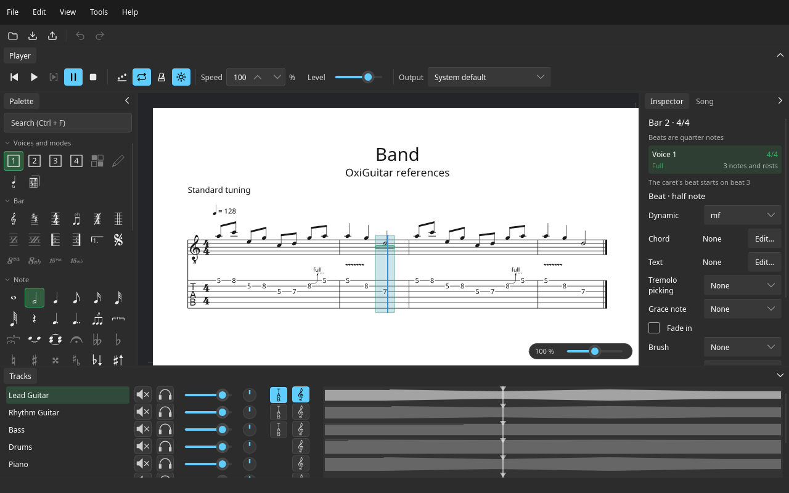
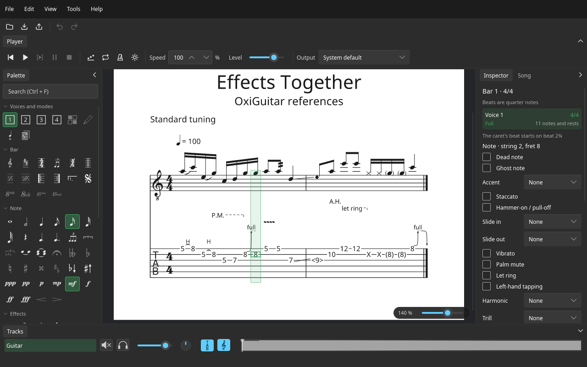
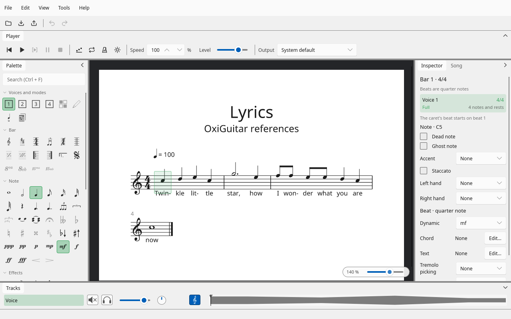
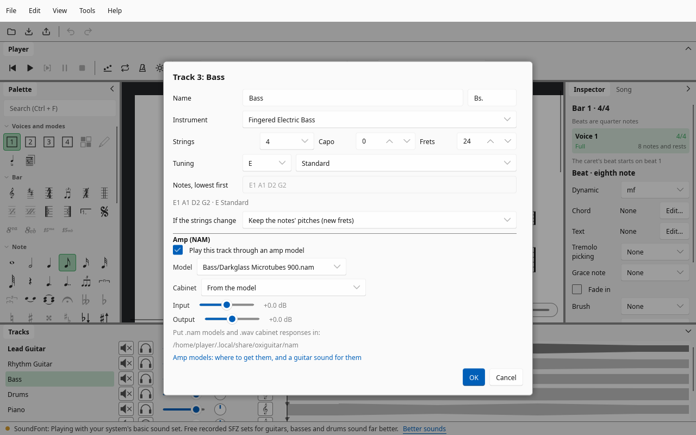
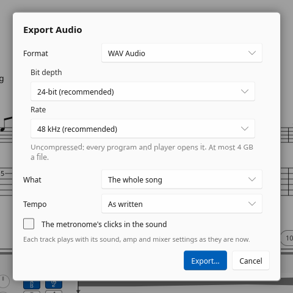
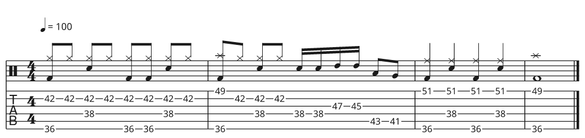

# OxiGuitar

<p align="center"></p>

**OxiGuitar** is a Free, Open-Source fully modular guitar tablature and score viewer, editor and player for Windows, macOS and Linux.

It is written entirely in Rust. Why Rust you'd ask? Because what do you get when you *Oxi*dise METAL \\m/? RUST! And because it’s very fast, of course. We don’t just *want* - we *need* great performance. First because we respect your hardware and your time (especially in this gawd damned economy), and second because we need a lot of grunt to give you a good experience with all the cool features we want in.

It opens the industry’s usual files (Guitar Pro 3 to 8, MusicXML, MIDI and TuxGuitar files), because no one wants to have to rewrite their entire tab collection they’ve been diligently maintaining since the 90’s just to be able to use Mat's fancy f\*cking app. It needs to be useful from the get-go. It shows them as standard notation and tablature and allows you to play, edit and save them. Every input/output format is a plugin, so you can write your own if we still don’t support what you need.

We support a wide variety of typesetting tools, and try to stay aligned with the music industry standard. Because what's the point of opening your fancy tabs and not being able to display all the work you put in it, right?

Playback is also big. We all like to play along with our favorite songs, don’t always have a band, and can’t always find a good backing track. So this is KEY. And we want quality here, because no one wants to be playing along to a cheap CASIO keyboard from the 90's operated by the neighbor’s toddler who just learnt a few chords and where that dumb arse automatic drumkit is! This is NOT a glorified metronome! Like file formats, every output method is a plugin. The most basic is a MIDI synthesizer that plays whatever sound fonts your computer already has (Windows and macOS come with one; on Linux it’s a package away). But we REALLY recommend that you get yourself some better ones – it makes a massive difference. We do have a few suggestions of nice free ones, with instructions on how to download, install and use them with OxiGuitar. And v1.0 brings some BIG tones too, using the famed *Neural Amp Modeler (NAM)* for some juicy realistic guitar tones. Compose your song, get yourself a sweet profile online (or capture your own rig with their software!) and you’ll have a pretty decent backing track to rock with real quick!

## New to some of these words?

- **Tablature (tab)**: six lines, one per string, with the fret to press written on the string. OxiGuitar shows it with standard notation above it, kept in step.
- **Plugin**: a single `.oxp` file that adds a file format, a sound, an effect or a tool. OxiGuitar itself only holds, shows, edits and plays the score; everything else is a plugin, so you install what you use ([the manual](https://mateusrdp.github.io/oxiguitar/plugins.html)).
- **Sound set (SoundFont, SFZ)**: a library of recordings of real instruments that turns notes into sound. Your system has a basic one; a good recorded one makes a massive difference ([the MIDI plugin's manual](https://mateusrdp.github.io/oxiguitar-midi/)).
- **NAM profile**: a capture of a real amp (or pedal, or whole rig) made with the open-source Neural Amp Modeler, the same `.nam` files that pedals from Darkglass, Fractal Audio, HeadRush and others now load. It's the profiling idea Kemper made famous, done in the open ([the NAM plugin's manual](https://mateusrdp.github.io/oxiguitar-nam/) explains profiling, modelling and cab IRs).
- **Cab IR**: an impulse response, a short `.wav` that sounds like a speaker cabinet and the microphone in front of it. Most amp profiles need one after them.
- **Temperament**: how the twelve notes of an octave are tuned. Everything digital plays perfect equal temperament; a real guitar doesn't, and True Temperament frets don't either. [The temperament plugin's manual](https://mateusrdp.github.io/oxiguitar-temperament/) explains why, with pictures.
- **`.oxg` file**: a small file OxiGuitar keeps beside a song for what that song's format can't hold (amp settings, a temperament, wah curves), so nothing is lost when you save.

## Privacy

OxiGuitar values your privacy first. It never uploads anything. No telemetry, no analytics, no automatic crash reports, no accounts, no background requests — not a single bit of data. It downloads nothing either: better sounds and plugins are files you get yourself and put in a folder, and the manual says where. The only network use ever planned is an update check you start yourself. If it crashes, it writes a log to your disk and tells you where it is; sending it to us is up to you. A CI test even runs OxiGuitar under a system-call tracer and fails if it ever tries to open a network connection to keep us honest. We don’t collect your data EVER. Because friends do **not** look at their friends’ browser histories.

**THAT SAID**, these promises cover the OxiGuitar core and the plugins we publish, and nothing else: we make no promises about plugins you get from anywhere else. Because again, OxiGuitar is fully modular, open-source and encourages the community to collaborate! **Anyone** can write plugins for it! **Be careful where you get your plugins from!** It’s **your** responsibility to check, and so you should! Ours is open-source, so you can peek inside anytime to see that there’s nothing funky in there and can even compile your own builds if you’re extra-paranoid and don’t trust GitHub with compiling even after reading the build scripts!

## Status

**v0.21.6, a pre-release for testers, 22 November 2026.** v1.0 is next, after a beta and the maintainer's own use. Since v0.18 came the TuxGuitar plugin, the Flatpak repository, the mixer saved with the song, drum entry on the drum staff, audio export to WAV, FLAC, MP3 and Opus, and four new plugins: wah-wah, temperament (real-guitar intonation and True Temperament), audio clips and an AI assistant.

OxiGuitar opens, shows, edits and saves Guitar Pro files and exports them to PDF. It supports pretty much every tool from TuxGuitar at least (more to come!). And it plays them: from the caret or the selection, looping, with a count-in and a metronome (heard, seen, or both), at 25 to 200 % speed, with each track's volume, pan, mute and solo, and a cursor on the very beat you're hearing. It uses the best sound set it finds: yours in the `soundfonts` folder, else the one your system has ([better sounds](https://mateusrdp.github.io/oxiguitar-bettersounds-soundfonts/)). `oxiguitar-cli play` plays a score from the terminal too. Built for v1.0: guitars and basses through **amp models** (Neural Amp Modeler captures) and cabinets, picked per track in its Properties ([the NAM plugin's manual](https://mateusrdp.github.io/oxiguitar-nam/)), and **File → Export Audio…**, the whole song or some bars, as written or at your practice speed ([the audio export plugin's manual](https://mateusrdp.github.io/oxiguitar-export/)). See [ROADMAP.md](ROADMAP.md) for what is done and what comes next, and [CHANGELOG.md](CHANGELOG.md) for what changed.

<p align="center"></p>

<p align="center">


</p>

<p align="center">


</p>

**Drums** are written on the drum staff, a key per kit piece as in Guitar Pro 8, or as their General MIDI numbers on drum tablature ([Drums](https://mateusrdp.github.io/oxiguitar/editing.html#drums)).

<p align="center"></p>

**Hear it:** a band with recorded guitars, bass and drums, the bass and the drum kit alone, guitar techniques, bends and strums, played by OxiGuitar with free sound sets, on the sound sets' [Hear it](https://mateusrdp.github.io/oxiguitar-bettersounds-soundfonts/hear-it.html) page. Amp modelling (NAM) examples come with v1.0.

## Install

OxiGuitar is the program plus **plugins**: it opens, plays and exports files only through them. A usable set is the program, the **Guitar Pro** and **MIDI** plugins, and an audio output (all recommended, and installed with the program by apt and dnf), then the extras we suggest: **Audio export** (your song as a WAV, FLAC, MP3 or Opus file), **NAM** (amp models), **Equalizer**, and the free **recorded sound sets** (clean, overdriven and distorted guitars, nylon and steel strings, ukulele, bass and drums; about 1.2 GB, downloaded from their authors after the package manager or the installer says so). The steps below install all of them. Leave out what you don't want: every name is a package of its own.

None of the downloads is code-signed yet, so Windows and macOS warn the first time you open OxiGuitar ([how to get past it](https://mateusrdp.github.io/oxiguitar/installing.html)). Nothing here runs unless you run it, and OxiGuitar itself never downloads anything.

### Debian, Ubuntu and relatives (apt)

**Once**, add our signed repository (it stays; you never repeat this):

```sh
sudo install -d -m 0755 /etc/apt/keyrings
sudo curl -fsSL https://mateusrdp.github.io/oxiguitar-packages/oxiguitar.gpg -o /etc/apt/keyrings/oxiguitar.gpg
sudo curl -fsSL https://mateusrdp.github.io/oxiguitar-packages/oxiguitar.sources -o /etc/apt/sources.list.d/oxiguitar.sources
sudo apt update
```

**Install** OxiGuitar with the recommended plugins (Guitar Pro, MIDI, ALSA and PipeWire audio) and the extras:

```sh
sudo apt install oxiguitar oxiguitar-export oxiguitar-nam oxiguitar-eq oxiguitar-wah oxiguitar-bettersounds-soundfonts
```

The last package asks whether to download the recorded sound sets (the default answer is yes; an unattended install downloads them). Say no, or install without it, and `sudo oxiguitar-install-sounds --system` fetches them any time later.

**Update** with your system's own updates, which now include OxiGuitar and every plugin you installed:

```sh
sudo apt update && sudo apt upgrade
```

### Fedora and relatives (dnf)

**Once**, add the repository (the same one, signed the same way):

```sh
sudo curl -fsSL https://mateusrdp.github.io/oxiguitar-packages/oxiguitar.repo -o /etc/yum.repos.d/oxiguitar.repo
```

**Install** (dnf adds the recommended plugins itself):

```sh
sudo dnf install oxiguitar oxiguitar-export oxiguitar-nam oxiguitar-eq oxiguitar-wah oxiguitar-bettersounds-soundfonts
```

The last package downloads the recorded sound sets as it installs, which takes a while; to skip that and fetch them later with `sudo oxiguitar-install-sounds --system`, install it with `sudo env OXIGUITAR_SKIP_SOUNDS=1 dnf install oxiguitar-bettersounds-soundfonts`.

**Update** with `sudo dnf upgrade`.

### Any Linux (Flatpak)

**Once**, add Flathub (for the runtime OxiGuitar runs on; nothing changes if you have it already) and our repository:

```sh
flatpak remote-add --if-not-exists flathub https://dl.flathub.org/repo/flathub.flatpakrepo
flatpak remote-add --if-not-exists oxiguitar https://mateusrdp.github.io/oxiguitar-packages/flatpak/oxiguitar.flatpakrepo
```

**Install** the program and its plugins, each a Flatpak add-on of its own (GNOME Software and KDE Discover list them under OxiGuitar):

```sh
flatpak install oxiguitar io.github.mateusrdp.OxiGuitar
flatpak install oxiguitar io.github.mateusrdp.OxiGuitar.Plugin.guitarpro io.github.mateusrdp.OxiGuitar.Plugin.midi io.github.mateusrdp.OxiGuitar.Plugin.pipewire io.github.mateusrdp.OxiGuitar.Plugin.export io.github.mateusrdp.OxiGuitar.Plugin.nam io.github.mateusrdp.OxiGuitar.Plugin.eq io.github.mateusrdp.OxiGuitar.Plugin.wah
```

The Flatpak runs in Flatpak's sandbox, which doesn't see your system's sound sets: download `install.sh` from the [sound-set installer's latest release](https://github.com/mateusrdp/oxiguitar-bettersounds-soundfonts/releases/latest) and run `bash install.sh`, which fills the Flatpak's own folder. **Update** with `flatpak update`. The manual's [Linux page](https://mateusrdp.github.io/oxiguitar/install-linux.html#flatpak-any-linux) lists every plugin and the Flatpak's folders.

### Any Linux (AppImage)

The AppImage is the program alone, with no repository to add and no automatic updates:

1. Download `OxiGuitar-VERSION-x86_64.AppImage` (or `aarch64`) from the [latest release](https://github.com/mateusrdp/oxiguitar/releases/latest), then `chmod +x` it and run it.
2. Download the Linux zip of each plugin from its latest release, unzip it and put the `.oxp` file in `~/.local/share/oxiguitar/plugins/`: [Guitar Pro](https://github.com/mateusrdp/oxiguitar-guitarpro/releases/latest), [MIDI](https://github.com/mateusrdp/oxiguitar-midi/releases/latest) and [ALSA](https://github.com/mateusrdp/oxiguitar-alsa/releases/latest) (the output the AppImage uses), then [Audio export](https://github.com/mateusrdp/oxiguitar-export/releases/latest), [NAM](https://github.com/mateusrdp/oxiguitar-nam/releases/latest), [Equalizer](https://github.com/mateusrdp/oxiguitar-eq/releases/latest) and [Wah-wah](https://github.com/mateusrdp/oxiguitar-wah/releases/latest).
3. For the sound sets, download `install.sh` from the [sound-set installer's latest release](https://github.com/mateusrdp/oxiguitar-bettersounds-soundfonts/releases/latest) and run `bash install.sh` in a terminal. It shows what it would download and asks first.

To update, download the newer files and replace the old ones.

### Windows

There is no repository to add yet (winget is planned), so everything is a download, and each plugin has a small setup program that installs for you alone, with no administrator password:

1. Unzip `OxiGuitar-VERSION-windows-x86_64.zip` (or `arm64`) from the [latest release](https://github.com/mateusrdp/oxiguitar/releases/latest) anywhere, and run `oxiguitar.exe`.
2. From each plugin's latest release, run its `-setup.exe`: [Guitar Pro](https://github.com/mateusrdp/oxiguitar-guitarpro/releases/latest), [MIDI](https://github.com/mateusrdp/oxiguitar-midi/releases/latest) and [WASAPI](https://github.com/mateusrdp/oxiguitar-wasapi/releases/latest) (the audio output), then [Audio export](https://github.com/mateusrdp/oxiguitar-export/releases/latest), [NAM](https://github.com/mateusrdp/oxiguitar-nam/releases/latest), [Equalizer](https://github.com/mateusrdp/oxiguitar-eq/releases/latest) and [Wah-wah](https://github.com/mateusrdp/oxiguitar-wah/releases/latest). Windows then lists them under Installed apps.
3. For the sound sets, download `install.ps1` from the [sound-set installer's latest release](https://github.com/mateusrdp/oxiguitar-bettersounds-soundfonts/releases/latest) and run `powershell -ExecutionPolicy Bypass -File .\install.ps1`. It shows what it would download and asks first.

To update, download the newer zip and setup programs and install them over the old ones.

### macOS

Open `OxiGuitar-VERSION-macos-universal.dmg` from the [latest release](https://github.com/mateusrdp/oxiguitar/releases/latest) and drag OxiGuitar to Applications, then run the `.pkg` installer from each plugin's latest release (no password needed): [Guitar Pro](https://github.com/mateusrdp/oxiguitar-guitarpro/releases/latest), [MIDI](https://github.com/mateusrdp/oxiguitar-midi/releases/latest) and [Core Audio](https://github.com/mateusrdp/oxiguitar-coreaudio/releases/latest), then [Audio export](https://github.com/mateusrdp/oxiguitar-export/releases/latest), [NAM](https://github.com/mateusrdp/oxiguitar-nam/releases/latest), [Equalizer](https://github.com/mateusrdp/oxiguitar-eq/releases/latest) and [Wah-wah](https://github.com/mateusrdp/oxiguitar-wah/releases/latest). To update, install the newer files over the old.

**The sound sets:** download `install.sh` from the [sound-set installer's latest release](https://github.com/mateusrdp/oxiguitar-bettersounds-soundfonts/releases/latest) and run `bash install.sh` in Terminal. It shows what it would download and asks first.

### After installing

Open a song. OxiGuitar plays each kind of track with the matching recorded set by itself (clean, overdriven and distorted guitars, nylon and steel strings, bass, drums); **Tools → Plugins…** lists the plugins it found and **Plugins → MIDI Sound Sets…** changes the sets. The [manual](https://mateusrdp.github.io/oxiguitar/) says more, and [the sound sets' manual](https://mateusrdp.github.io/oxiguitar-bettersounds-soundfonts/) lists them.

## How to get involved

I’m a pretty good computer scientist and software engineer myself but this is all vibe-coded at the moment, just to get a headstart. Get the grunt work out of the way, and get something working quick. Cause, you know, I have a life, a full time job, and not a lot of time or money to spare (f\*ck, I even like to play the guitar when I can!). But I promise I have been VERY strict with Claude – if the machines turn on us, it *might* be because I have been so mean to them, just saying. Once we get something good out, we REALLY wanna have this all code reviewed by humans. De-slopify this sh\*t! Meanwhile we REALLY wanna have this all at least thoroughly tested by humans. Because Claude and I are doing all we can with what we have.

That’s where **you** come in. Yes, you.

How can you help, you ask?

1. **USE IT!** Let us know what you think in the discussion pages! Report bugs when you find them!
2. **TELL YOUR FRIENDS!** The more people using it and getting involved the better!
3. **GET YOUR HANDS DIRTY!** This is open-source! So, are you a good dev too? SWEET, how about you help us squash a few bugs? Had a wild idea? Go and write a plugin for it or something! Implement a new feature to make the core better! I don’t know! Follow your dreams or whatever! You have the source code, don't you?
4. **BUY ME A DRINK** to say thanks and/or **CHIP IN TO BUY MORE USAGE TOKENS**. Cause yeah, this takes time and resources. And Dario Amodei’s butt lift isn’t paying for itself.

[](https://www.paypal.com/donate/?business=4QYDZY4RP8V8L&no_recurring=0&item_name=Thanks+heaps!+You+rock!&currency_code=AUD&source=qr)


# Nerd Section

## Supported systems

| System | Versions | CPUs |
| --- | --- | --- |
| Windows | 10 and later | x86\_64, ARM64 |
| Linux | the AppImage: distributions with glibc 2.35 or newer (Debian 12 and later, Ubuntu 22.04+, Fedora 36+); the .deb and .rpm: glibc 2.39 or newer (Debian trixie and sid, Ubuntu 24.04+, Fedora 40+) | x86\_64, ARM64 |
| macOS | the current release | Apple Silicon and Intel (one universal app) |

Each [release](https://github.com/mateusrdp/oxiguitar/releases) has one download for your system: a portable .exe for Windows (in a zip); one AppImage for any Linux, which holds both the Wayland and the X11 build, starts the right one and plays through ALSA (which PipeWire desktops pass on to PipeWire); a .deb and an .rpm for Debian, Ubuntu and Fedora; one .dmg for macOS. **None carries the plugins** that open Guitar Pro files and play them: those live in repositories of their own ([oxiguitar-guitarpro](https://github.com/mateusrdp/oxiguitar-guitarpro), [oxiguitar-midi](https://github.com/mateusrdp/oxiguitar-midi), [oxiguitar-nam](https://github.com/mateusrdp/oxiguitar-nam), [oxiguitar-export](https://github.com/mateusrdp/oxiguitar-export) and the audio outputs), with releases, packages and updates of their own. The Linux package repositories below install OxiGuitar and its plugins together and keep them up to date.

Every release carries a SHA256SUMS file. The .deb, .rpm and .dmg register the Guitar Pro file types (.gp, .gpx, .gp5, .gp4, .gp3), so double-clicking a file opens OxiGuitar; the portable .exe and the AppImage register nothing, and the [user manual](https://mateusrdp.github.io/oxiguitar/installing.html) shows how to do it by hand. The [manual](https://mateusrdp.github.io/oxiguitar/) explains the whole program in a few short pages.

- **Installing:** the [Install](#install) section above has the steps for each system, from adding our repositories (a one-off step) to updating.
- **Linux on X11:** the AppImage works on X11 as it is. The .deb and .rpm above are the Wayland build, for today's desktops; a desktop without Wayland needs the X11 build's package instead, `oxiguitar-x11_….deb` or `oxiguitar-x11-….rpm`. The X11 build is deprecated and will be dropped. Each build carries only its own display system's code, and installing one package replaces the other.

None of the packages is code-signed yet, so the first launch shows a warning:

- **Windows:** SmartScreen says "Windows protected your PC". Click **More info**, then **Run anyway**.
- **macOS:** right-click (or Control-click) the app, choose **Open**, then **Open** again. On recent macOS versions you may instead need **System Settings → Privacy \& Security → Open Anyway**.
- **Linux AppImage:** make it executable (`chmod +x OxiGuitar-*.AppImage`), then run it.

## Building from source

You need Rust 1.99 or newer, from [rustup](https://rustup.rs): distributions' own Rust packages are usually older. On Debian and Ubuntu:

```
sudo apt install git build-essential pkg-config rustup \
  libfontconfig1-dev libxkbcommon-dev libwayland-dev
rustup default stable
git clone https://github.com/mateusrdp/oxiguitar.git
cd oxiguitar
cargo build --release
cargo test
```

Elsewhere, install rustup from your system's packages or from [rustup.rs](https://rustup.rs). The `lib…-dev` packages are the system libraries OxiGuitar needs: fontconfig, xkbcommon and Wayland for fonts, keyboard and windows. The audio output plugins, in their own repositories, need ALSA's and PipeWire's.

The program opens files only through format plugins (one per format, `.oxp` files), which are built from the plugin repositories ([oxiguitar-guitarpro](https://github.com/mateusrdp/oxiguitar-guitarpro) and the others; each has a `build-oxp.sh`). A build from source looks for them in `target/lib/oxiguitar/plugins/` beside the program on Linux, in `plugins\` beside the .exe on Windows, and in your own plugin folder everywhere; `cargo test` takes the latest releases of the plugins it needs by itself (`OXIGUITAR_PLUGINS_DIR` points it at a folder of your own builds instead).

Run the desktop app, optionally with a file to open:

```
cargo run --release -p oxiguitar-app -- path/to/your/song.gp
```

That is the Wayland build, the default. On a desktop with only an X server, build the X11 one instead: `cargo run --release -p oxiguitar-app --no-default-features --features x11 -- song.gp`. Each build carries only its own display system's code, and says which build you need if it can't find its session.

File → New starts a score; the [manual's Editing page](https://mateusrdp.github.io/oxiguitar/editing.html) and [Keyboard and mouse](https://mateusrdp.github.io/oxiguitar/keys.html) list the keys. On Linux, the Open and Export dialogs come from the desktop portal (`xdg-desktop-portal` with your desktop's backend, installed by default with GNOME and KDE). The binary is `target/release/oxiguitar`; it finds the plugins in `target/lib/oxiguitar/plugins/`, and in your own plugin folder ([Settings and plugins](https://mateusrdp.github.io/oxiguitar/plugins.html)). On Wayland, desktops take an app's icon from its desktop entry rather than from the window; to give a build from source (or an AppImage) its icon, a menu entry and the Guitar Pro file types, run `scripts/install-desktop-entry.sh [path to the program]` (it writes only to `~/.local/share`; `--uninstall` removes it).

Try the command-line tool, which reads files through the same plugins (Guitar Pro 3 to 8: .gp3, .gp4, .gp5, .gpx, .gp) and engraves them into PNG pages and a PDF:

```
cargo run --release -p oxiguitar-cli -- info fixtures/gp/oxiguitar-test-song.gp
cargo run --release -p oxiguitar-cli -- info --bars path/to/your/song.gp5
cargo run --release -p oxiguitar-cli -- render path/to/your/song.gp --png page --pdf song.pdf
cargo run --release -p oxiguitar-cli -- render path/to/your/song.gp --tracks all --dark --pdf song-dark.pdf
cargo run --release -p oxiguitar-cli -- render path/to/your/song.gp --tool infer-key-signatures --no-dynamics --pdf keys.pdf
cargo run --release -p oxiguitar-cli -- convert path/to/your/song.gp3 song.gp
cargo run --release -p oxiguitar-cli -- play path/to/your/song.gp --wav song.wav
```

## Writing plugins

Every file format, tool and tab in OxiGuitar is a plugin: one `.oxp` file, an archive of a small manifest, a native library built from Rust with our SDK and any files the plugin ships. The [plugin developer guide](https://mateusrdp.github.io/oxiguitar/plugin-guide/) walks through it from its template (`docs/plugins/template/`), and plugins may use any GPL-compatible license, since the interface and the SDK are MIT OR Apache-2.0.

## Testers wanted

The maintainer tests by hand on x86\_64 Debian sid only. Everything else — **Windows, macOS, other Linux distributions, and any ARM64 machine** — is built and tested automatically, but nobody has clicked through it yet. If you can try test builds on one of those systems, please say hello in [Discussions](https://github.com/mateusrdp/oxiguitar/discussions) or open an issue with what you find.

Test builds of every change on `develop` (the program for each system, its plugins, and the songs we write as .gp and .gp5 for checking in Guitar Pro) are under the [Actions](https://github.com/mateusrdp/oxiguitar/actions/workflows/builds.yml) tab, kept for 14 days (you need to be signed in to GitHub to download them). Packages of the latest state are made by hand under [Release packages](https://github.com/mateusrdp/oxiguitar/actions/workflows/release.yml), kept just as long.

## Contributing

Pull requests are welcome from day one. Read [CONTRIBUTING.md](CONTRIBUTING.md) first: it covers code standards, the sign-off rule and how to add a file format or an effect. [ARCHITECTURE.md](ARCHITECTURE.md) explains how the code fits together, what it can't do yet, what is left out on purpose and where help is most wanted, and [docs/adr/](docs/adr/) records why things are the way they are.

## Donations

See [How to get involved](#how-to-get-involved), point 4. The same PayPal link and QR code are in the app, under **Help → About**.

## Testing

Every test, with one command (the manual's Testing page says more, and how to report a failure):

```sh
python3 scripts/test-all.py --corpus DIR
```

## Credits

OxiGuitar stands on the shoulders of a lot of generous people, and we're grateful to every one of them. The core is built on [Slint](https://slint.dev) (the window), [krilla](https://github.com/LaurenzV/krilla) (PDF), [tiny-skia](https://github.com/linebender/tiny-skia) and [skrifa](https://github.com/googlefonts/fontations) (drawing and fonts), [chordparser](https://github.com/PauSala/chordparser) (chord names), [rtrb](https://github.com/mgeier/rtrb) (the real-time queues), [libloading](https://github.com/nagisa/rust_libloading) and [object](https://github.com/gimli-rs/object) (loading plugins), [postcard](https://github.com/jamesmunns/postcard) and [serde](https://serde.rs) (the plugin messages), [rfd](https://github.com/PolyMeilex/rfd) (file dialogs), and the [Bravura](https://github.com/steinbergmedia/bravura) and [Noto Sans](https://github.com/notofonts/latin-greek-cyrillic) fonts. We learn from [MuseScore](https://github.com/musescore/MuseScore), [TuxGuitar](https://github.com/helge17/tuxguitar), [alphaTab](https://github.com/CoderLine/alphaTab), [PyGuitarPro](https://github.com/Perlence/PyGuitarPro), [Verovio](https://github.com/rism-digital/verovio) and [sfizz](https://github.com/sfztools/sfizz). [CREDITS.md](CREDITS.md) lists every one of them with its authors and licence, and the manual's [Credits](https://mateusrdp.github.io/oxiguitar/credits.html) page too; each plugin credits its own in its repository.

Thank you, all of you. And thanks to everyone who tests, reports bugs and tells their friends.

## License

OxiGuitar is free software under the [GNU General Public License, version 3](LICENSE). Our own code is GPL-3.0-or-later; the program as distributed is GPL-3.0, because code ported from MuseScore keeps its GPL-3.0-only license. The plugin interface and the SDK for plugin authors (`oxiguitar-plugin-api`, `oxiguitar-plugin`) are MIT OR Apache-2.0, so plugins may use any GPL-compatible license.

Copyright (C) 2026 Mateus Rocha de Paula and the OxiGuitar contributors. [CREDITS.md](CREDITS.md) lists every project we build on and thanks everyone who has contributed.

Guitar Pro is a trademark of Arobas Music. MuseScore is a trademark of Muse Group. OxiGuitar is not affiliated with either.
