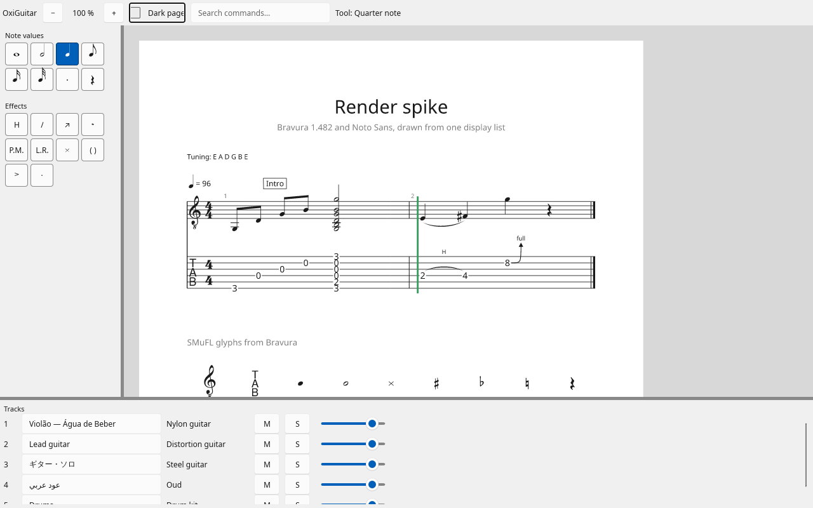
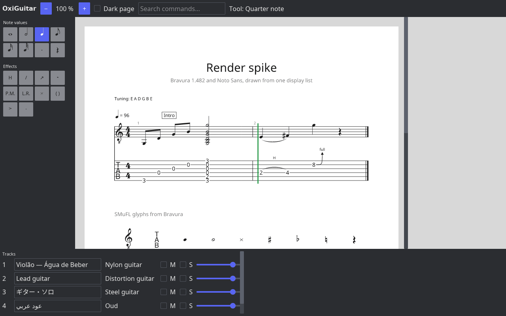
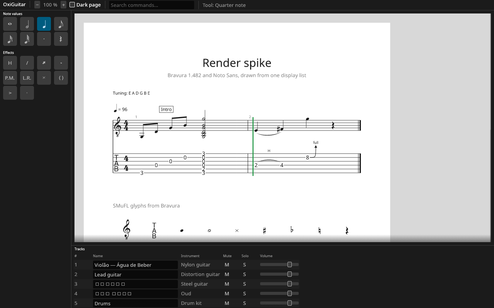

# 0004 — GUI toolkit: Slint

- Status: proposed (Mateus accepts or rejects it when reviewing the M0 pull request into `main`)
- Date: 2026-10-15
- Milestone: M0

## Context

The brief left the GUI shell to a spike between Slint, iced and egui, scored on five criteria: palette and docking support, keyboard and screen-reader access, text input in all languages, API stability, and a path to Android and iPad. The window should look and behave as much like Guitar Pro 8 as possible (UI-1, UI-2): toolbar on top, edition palette on the left, inspector on the right, tracks and mixer along the bottom, with Guitar Pro's shortcuts. The GUI stays a thin shell; the score canvas is our own renderer (ADR 0005), so the toolkit only has to show its pixels.

### What the spike built

`spikes/gui/` holds the same screen in each toolkit, with the same shared code (`spike-common`):

- a palette of 18 tools in two groups, with Bravura symbols on the buttons, tooltips naming the tool and its shortcut, and selected states;
- single-key shortcuts that do nothing while a text field has focus, and Ctrl +/− to zoom;
- a command search field that filters the palette;
- a track list with editable names (in Portuguese, Japanese and Arabic), mute, solo and volume;
- the score canvas: our renderer drawing only the visible part of the specimen page, with zoom, scrolling and a dark page.

The Slint spike also has two splitters, to check how much work Slint's missing splitter widget is.

Versions: Slint 1.18.1 (21 Sep 2026), iced 0.14.0 (7 Dec 2025, the latest release), egui and eframe 0.36.2 (8 Sep 2026). All three build with rustc 1.97, our minimum.

We ran each spike under a virtual X server with software OpenGL, drove it with synthetic key presses, clicks and drags, and took screenshots:

- All three show the palette, the canvas and the track list, react to the shortcuts, filter the palette as you type, zoom, scroll and switch to the dark page.
- **Japanese and Arabic track names** display correctly in Slint and iced, the Arabic joined and right to left. egui shows empty boxes for both: it uses only the fonts the app bundles.
- **Tab** moves a visible focus ring through buttons and fields in Slint and egui. In iced it reaches only the text fields.
- The Slint splitters resize the palette and the track list, and the palette rewraps.

| Slint | iced | egui |
| --- | --- | --- |
|  |  |  |

Screen-reader and input-method support comes from each toolkit's source code and release notes, because the session machine has neither; the Debian checklist in the pull request covers them by hand.

### Measurements

| | Slint 1.18 | iced 0.14 | egui 0.36 |
| --- | --- | --- | --- |
| Our code (lines) | 164 Rust + 272 `.slint` | 231 Rust | 228 Rust |
| Crates in the build | 370 | 344 | 283 |
| Release binary, Linux x86_64 (incl. 2.8 MB of fonts) | 25 MB | 19 MB | 21 MB |
| Clean release build, 2 cores | 7 min 39 s | 7 min 11 s | 7 min 5 s |
| Rebuild after touching `main.rs` (release, thin LTO) | 104 s | 108 s | 93 s |
| Minimum Rust | 1.92 | 1.88 | 1.95 |
| System libraries linked on Linux (besides libc) | fontconfig, freetype (system fonts) | none | none |
| Licence | GPL-3.0-only, or Slint's royalty-free licence | MIT | MIT OR Apache-2.0 |

## Options

Scores run from 1 (fails the need) to 5 (fully meets it).

| Criterion | Slint | iced | egui |
| --- | --- | --- | --- |
| Palette and docking | 3 | 4 | 5 |
| Keyboard and screen readers | 5 | 1 | 4 |
| Text input in all languages | 5 | 4 | 3 |
| API stability | 5 | 2 | 2 |
| Path to Android and iPad | 5 | 1 | 3 |
| **Total** | **23** | **12** | **17** |

### Palette and docking

- **Slint:** the palette was easy to declare as a component with its own focus, tooltip and accessible name, and `FlexboxLayout` wraps its buttons. There is no docking and no splitter widget; our splitter took 20 lines. Guitar Pro 8's window has fixed panels that collapse rather than free docking, so splitters are what we need.
- **iced:** `pane_grid` is built in, with splitting, resizing and drag-to-swap. Buttons and tooltips are fine.
- **egui:** resizable side and bottom panels are built in, and two maintained docking crates (`egui_dock` 0.21 and `egui_tiles` 0.17) already follow egui 0.36. Custom widgets are a few lines; we wrote one for the palette buttons because egui sizes a button by its font's line height, which is very tall for a music font.

### Keyboard and screen readers

- **Slint:** AccessKit on Windows, macOS and Linux. Every element has `accessible-role`, `-label`, `-checked` and actions; 1.17 and 1.18 exposed text-input contents, selection and live regions. Tab focus navigation is built in. Native menu bars on macOS, with shortcuts shown, since 1.16.
- **iced:** no screen-reader support: there is no AccessKit or any other accessibility code in iced 0.14. Only text inputs can take keyboard focus, so palette buttons and checkboxes cannot be reached by Tab.
- **egui:** AccessKit is always on since 0.34, and built-in widgets describe themselves. Custom widgets must call `widget_info` to be named, as our palette button does. Tab navigation is built in.

### Text input in all languages

- **Slint:** input methods on all desktop systems and on Android and iOS, text shaped by parley and harfrust with bidirectional text, and fallback to system fonts through fontconfig on Linux, so Japanese and Arabic names display without bundling fonts.
- **iced:** input-method support arrived in 0.14; cosmic-text shapes text, handles bidirectional text and falls back to system fonts.
- **egui:** input methods work on the desktop; 0.36 shapes text with harfrust but does not reorder right-to-left text (its source marks bidi as future work), and it never looks at system fonts, so every script must be bundled by the app.

### API stability

- **Slint:** stable 1.x API since April 2023, a minor release about every two months; breaking changes stay behind features named `unstable-*`. Deprecated names keep working with a warning (we hit two in the spike).
- **iced:** 0.x, with breaking changes in every release; 0.14 is ten months old and is mostly one maintainer's work.
- **egui:** 0.x, four releases in the last twelve months, each with breaking changes (0.34 replaced `App::update` and the panel types; 0.35 removed the deprecated items; 0.36 changed input events). Its minimum Rust rose from 1.88 to 1.95 during 2026, which matters because our minimum follows Debian unstable's rustc.

### Path to Android and iPad

- **Slint:** official Android support, and iOS since 1.12; 1.18 adopted the scene lifecycle iOS 27 requires.
- **iced:** none.
- **egui:** eframe builds for Android behind feature flags and has iOS code paths, but neither has packaging tooling, and mobile text input is described as working through the web build.

### Other findings

- **Hosting our canvas** worked in all three. egui was the most direct (a scroll area that reports its visible rectangle). Slint needed `changed` callbacks on the scroll position to request a new frame. iced needed a cache inside `view`, which only gets `&self`, and offers no simple way to read the screen's scale factor there.
- **Look and feel:** Slint's declarative files and styles suit a Guitar Pro-like look; egui looks like egui unless restyled widget by widget.
- **Licence:** Slint's GPL-3.0-only option fits OxiGuitar, whose distributed program is GPL-3.0 already. Publishing on Apple's App Store (M9) conflicts with the GPL whatever the toolkit, and needs its own decision before M9.

## Decision

Slint. It is the only candidate that meets the accessibility, international-text and mobile requirements today, and the only one with a stable API, which suits a project that will live for years with a thin GUI on top. We build what it lacks, splitters and collapsible panels, and draw our own icons for the palette (UI-3), which also removes the music-font metric problems we saw on palette buttons in all three toolkits.

egui is the fallback if Slint stalls: it scored second and is the easiest to extend.

## Consequences

- `oxiguitar-app` (M1) uses Slint 1.x with the winit backend; the screen lives in `.slint` files, the logic in Rust. The score canvas is an `Image` fed by `oxiguitar-render`, as in the spike.
- Linux builds need `libfontconfig1-dev`, `libxkbcommon-dev` and `libwayland-dev` (already on the brief's list); `libasound2-dev` arrives with audio in M3. The README lists them.
- In M1 we turn the spike's splitter into a collapsible panel component and write the Guitar Pro-like style.
- CI builds the spikes on all five desktop targets (`.github/workflows/spikes.yml`, advisory); the first run shows whether each toolkit builds on Windows ARM64.
- Revisit if Slint changes its licence terms, if a 1.x release breaks us without warning, or if Mateus's hands-on test on Debian (screen reader, input methods) finds a blocker.
