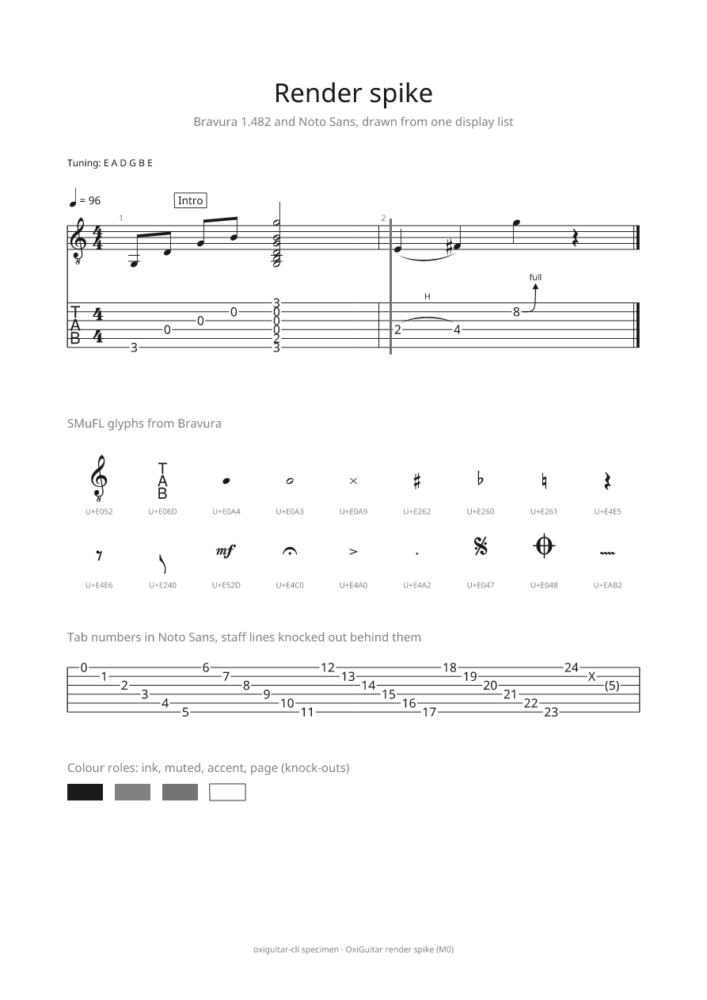

# 0005 — Renderer: one display list, drawn on the CPU for the screen and by krilla for PDF

- Status: accepted
- Date: 2026-10-15
- Milestone: M0

## Context

The brief's design rule is that layout produces a display list, and the screen, PDF, PNG and SVG all draw that same list, so what you see is what you export. It left open whether the score canvas draws on the GPU or the CPU, proposed krilla for PDF, and chose Bravura with its SMuFL metadata file as the music font.

The requirements that bear on the renderer:

- VIEW-5: zoom from 25 % to 400 %, smooth scrolling on a 300-bar, 8-track score.
- VIEW-7 and VIEW-8: SMuFL glyphs, and light, dark and inverted pages.
- EXP-1: vector PDF, A4 or Letter, fonts embedded as subsets. EXP-2 later: PNG and SVG.
- Testing: visual regression on 50 reference scores, run in CI on six targets.
- The GUI stays a thin shell (ADR 0004), and nothing but OS libraries may be non-Rust.

### What the spike built

Two crates, kept as the start of the real renderer:

- **`oxiguitar-display`**: the display list. Items are glyph runs (glyph ids already positioned, plus their text), lines, filled rectangles and Bézier paths, in points from the page's top-left corner. Colours are roles (ink, page, accent, muted) that a theme resolves, so one list draws on a light or dark page. It also holds the bundled fonts, the SMuFL metadata reader (engraving defaults, bounding boxes, anchors) and a hand-placed specimen page: a two-bar excerpt in standard notation and tablature with a beam, a slur, a hammer-on, a bend, ledger lines, tab numbers with the staff lines knocked out behind them, 18 sample SMuFL glyphs and a row of tab numbers 0–24.
- **`oxiguitar-render`**: two backends. `raster` fills glyph outlines read with skrifa, and the list's lines and paths, with tiny-skia on the CPU; it draws any rectangle of the page at any scale, so the GUI asks only for what is visible. `pdf` writes the list with krilla, embedding font subsets and the text of each run.

`oxiguitar-cli specimen --png page.png --pdf page.pdf [--scale N] [--dark]` draws the specimen, and all three GUI spikes show it as their score canvas.

### What we measured

On the session's cloud machine (one 2.1 GHz Xeon core, release build, rustc 1.97):

| Case | Time |
| --- | --- |
| Building the specimen's display list (205 items) | 0.1–0.2 ms |
| A4 page at 200 % zoom (1191 × 1684 px), glyph outlines cached | 9–13 ms |
| Dense page (6 systems, 540 items), 1920 × 1080 window at 100 % | 7.4 ms |
| Same, 1920 × 1080 window at 400 % | 4.1 ms |
| Same, 3840 × 2160 window at 200 % on a HiDPI screen | 16.2 ms |
| Writing the PDF | 2–4 ms, 23.9 KB |

- **The PDF is what EXP-1 asks for.** `pdffonts` lists Noto Sans as an embedded CID TrueType subset and Bravura as an embedded CID Type 0C subset, both with Unicode maps; `pdftotext` extracts the title, captions and tab numbers.
- **The screen and the PDF agree.** We rendered our PDF with Poppler at 144 dpi and compared it with our own raster at the same size. After a 2-pixel blur, which removes anti-aliasing differences, no pixel differs by more than 48 of 255; the remaining differences are glyph edges and Poppler's thickening of hairlines. Nothing is moved or missing.
- **Every SMuFL glyph comes from the metadata.** Stems attach at Bravura's `stemUpSE` and `stemDownNW` anchors, line thicknesses come from its engraving defaults, and a test checks that each glyph we name exists in both the font and the metadata.

## Options

1. **CPU raster of the display list (tiny-skia).** The GUI shows the pixels as an image. The same code writes PNG files and the images visual regression tests compare, and it gives the same result on every system because no GPU driver is involved. Any toolkit can show an image, so the canvas does not depend on the toolkit. Cost: a full 4K redraw takes about 16 ms on one slow core, so M1 needs tiles and a worker thread for smooth scrolling.
2. **GPU vector rendering (vello on wgpu).** Fastest at 4K and for animated zoom. But vello needs compute shaders, so weaker GPUs, virtual machines and CI runners need a fallback anyway; its output differs slightly from any CPU path, so visual tests would compare something other than what users see; and it ties the canvas to the toolkit's wgpu version, which differs between toolkits (wgpu 27 in iced 0.14, 30 in egui 0.36, a versioned "unstable" feature in Slint).
3. **Each toolkit's own drawing API** (egui's painter, iced's canvas, Slint's `Path`). Three text pipelines, none of them the PDF's, and the score would be tied to the toolkit, against the thin-GUI rule.

## Decision

Option 1. Layout produces an `oxiguitar-display` list; `oxiguitar-render` draws it with tiny-skia for the screen, PNG export and visual tests, and with krilla for PDF. Both backends take every glyph position from the list, so they cannot disagree on layout. Bravura 1.482 with its metadata is the music font and Noto Sans the text and tab-number font, both bundled under the SIL Open Font License.

## Consequences

- **M1 work on the canvas:** render the page in tiles (about 512 × 512 px) on a worker thread, keep tiles for the current zoom, and scroll by moving tiles rather than redrawing. With the timings above that keeps scrolling well inside a 60 Hz frame.
- **Text shaping:** the spike places text one glyph per character, which is right for tab numbers and Latin titles. M1 adds `harfrust` (a pure-Rust port of HarfBuzz) behind the same function, for kerning, ligatures and lyrics in any script; bidi text follows with it.
- **Visual regression tests** use the raster backend, with a small tolerance because SIMD code paths may round edge pixels differently on x86_64 and ARM64.
- **PNG export (EXP-2) is already done** in effect; SVG is a third backend of about the size of the PDF one.
- **Fonts are compiled into the program for now** (about 2.8 MB with the metadata). The OFL requires their copyright notice and licence to travel with them: `assets/fonts/` keeps both, and the release's third-party licence file and the About window must include them (M1). Leland can be added as a second music font with its own metadata file.
- **krilla** is MIT OR Apache-2.0; its NOTICE file credits snippets adapted from resvg (MPL-2.0) and from typst, svg2pdf and vello (Apache-2.0). All are compatible with GPL-3.0; CREDITS.md records this.
- **Revisit** if, after tiling, scrolling a 300-bar, 8-track score at 400 % on a mid-range laptop drops frames, or if the M9 tablet companion needs the GPU. Then a vello backend can sit beside the CPU one, drawing the same list.
