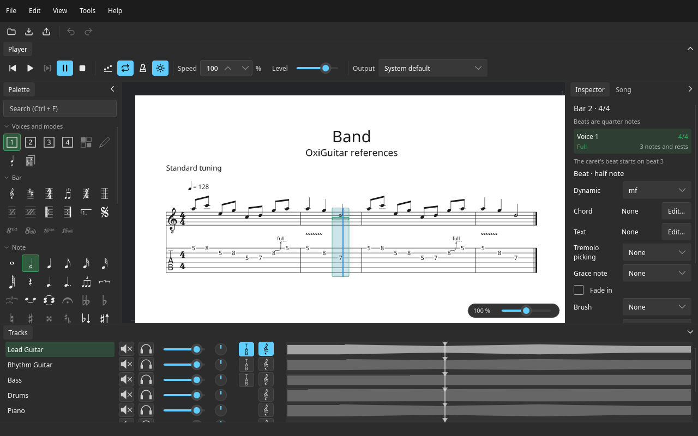

# OxiGuitar

OxiGuitar is a free guitar tablature and score viewer, editor and player for Windows, macOS and Linux. Open a tab you downloaded, read it as tablature and standard notation, fix or write it, play it back with every instrument of the band, slow it down to practise, and save it or print it.

The window has menus and a toolbar at the top, the player above the score, the palette on the left, the song's information, the track, the bar and the note on the right, the score in the middle, the track list with each track's mixer along the bottom and a line of messages at the very bottom: see [The window](window.md). Shortcuts are in [Keyboard and mouse](keys.md).

## Tablature, notation and why you get both

Guitarists mostly read **tablature** ("tab"): one line for each string, with a number on a line saying which fret to press. It tells you *where* to play every note, and it has signs for what guitarists do: bends, slides, hammer-ons, vibrato, palm mutes. What plain tab doesn't say well is *when*: how long each note lasts.

**Standard notation** is the reverse: it spells out pitch and rhythm exactly, but not which string to play a note on.

OxiGuitar shows either or both, one above the other and kept in step: change a fret and the note above it changes with it. Each track can show what suits it ([Tracks and notation](tracks.md)).

## Everything is a plugin

OxiGuitar itself is a small program: the score, the editor, the engraver that draws the page, and the player that decides what should sound when. Everything that touches the world outside is a **plugin**, a single `.oxp` file:

- **File formats.** Guitar Pro, MusicXML, MIDI files and TuxGuitar each come from a plugin. Without one, OxiGuitar can't open anything.
- **Sound.** One plugin turns the notes into sound (the MIDI plugin, with sound sets), effect plugins shape it (an amp model, an equalizer, a wah), and an output plugin sends it to your speakers.
- **Extras.** Audio export, audio clips, a different temperament, an AI assistant.

That keeps OxiGuitar lean and lets you install only what you use, and anyone can write a plugin for what we don't support yet. The package managers install a sensible set for you ([Installing](installing.md)); [Plugin manuals](official-plugins.md) lists them all, each with a manual of its own.

## Sound sets

When OxiGuitar plays a song, the MIDI plugin plays each note with a **sound set**: a library of recordings of real instruments. Every system has a basic one, so a song plays the moment it opens. A good recorded set makes a huge difference, and there is a free, recommended collection to download. The MIDI plugin's manual explains it ([Plugin manuals](official-plugins.md)).

## Nothing is lost when saving

Each file format holds some things and not others: a `.gp5` file has no place for an amp setting, a MusicXML file has no whammy bar. When you save, OxiGuitar tells you what the format can't hold and offers to keep it in a small **`.oxg`** file beside the song, which it reads back the next time you open it ([Saving files](saving.md)).

## Privacy

OxiGuitar never connects to the internet on its own and never sends anything anywhere: no telemetry, no accounts, no automatic crash reports. It downloads nothing either.

Found a problem, or something missing from this manual? Open an [issue](https://github.com/mateusrdp/oxiguitar/issues) or ask in [Discussions](https://github.com/mateusrdp/oxiguitar/discussions). [Credits](credits.md) thanks the projects OxiGuitar is built on.
