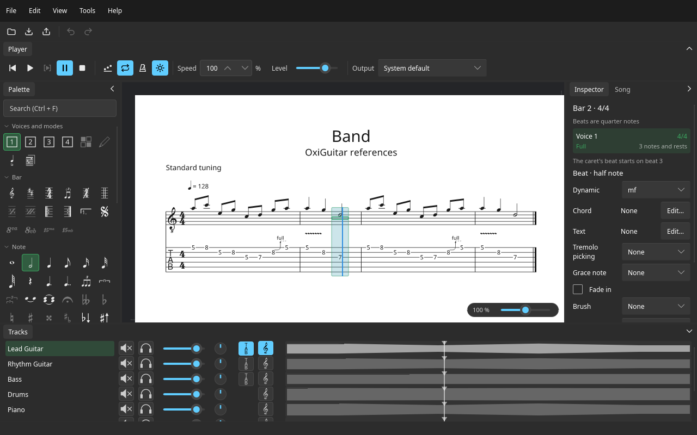

# OxiGuitar

OxiGuitar is a free guitar tablature and score viewer, editor and player for Windows, macOS and Linux. It opens Guitar Pro files, shows them as standard notation and tablature, edits them, saves them as .gp and .gp5, exports them to PDF, and plays them ([Playing a score](playback.md)) with the sound sets your system has or better ones you add ([Better sounds](better-sounds.md)).

The window has menus and a toolbar at the top, the player above the score, the palette on the left, the Inspector and the song's information on the right, the score in the middle, the track list with each track's mixer along the bottom and a line of messages at the very bottom: see [The window](window.md). Shortcuts are in [Keyboard and mouse](keys.md).

**Privacy.** OxiGuitar never connects to the internet on its own and never sends anything anywhere: no telemetry, no accounts, no automatic crash reports.

Found a problem, or something missing from this manual? Open an [issue](https://github.com/mateusrdp/oxiguitar/issues) or ask in [Discussions](https://github.com/mateusrdp/oxiguitar/discussions).
